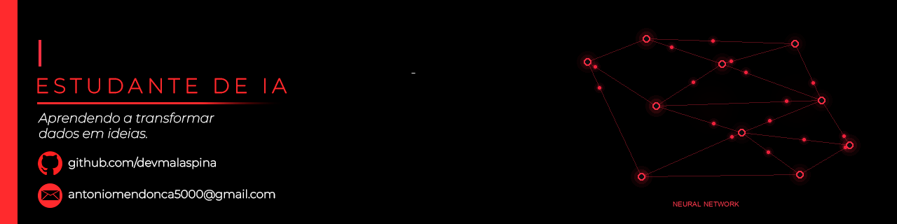

  

---

  Estudante de Inteligência Artificial pela Universidade Federal de Jataí (UFJ). Atualmente participo de diversos projetos que envolvem IA ofertados pela faculdade. Estou constantemente aprimorando meus conhecimentos sobre os conceitos, bibliotecas e o funcionamento da área de IA, e sempre à procura de desafios na área da tecnologia. Tenho uma grande paixão por aprender e, principalmente, replicar esse conhecimento para criar soluções inovadoras.

---

### Conecte-se comigo!

### Minha Stack ~

&nbsp;
&nbsp;
&nbsp;

 

---

<h3 align="center">✦ GitHub Stats ✦</h3>

  

  <picture>
    <source media="(prefers-color-scheme: dark)" srcset="https://raw.githubusercontent.com/devmalaspina/devmalaspina/output/github-snake-dark.svg" />
    <source media="(prefers-color-scheme: light)" srcset="https://raw.githubusercontent.com/devmalaspina/devmalaspina/output/github-snake.svg" />
    
  </picture>

